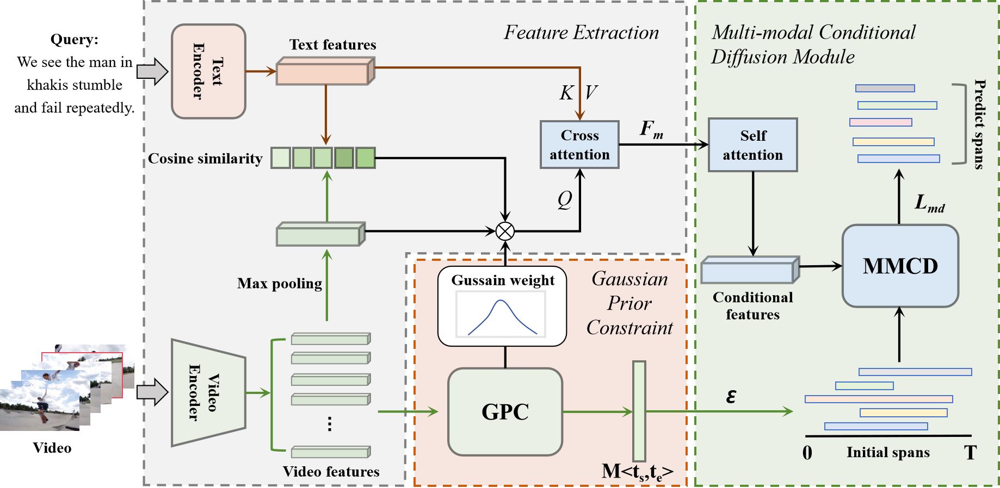

# PointDiff

Official PyTorch implementation of the paper:  
**"PointDiff: Conditional Diffusion Model for Point-supervised Video Moment Retrieval."**  
[[📄 Paper Link](https://ieeexplore.ieee.org/document/11449454)]]

---

## 🧠 Overview
This repository contains the official implementation of our paper *"PointDiff: Conditional Diffusion Model for Point-supervised Video Moment Retrieval."*, which focuses on **video understanding** in the field of deep learning.  

---

## 🏗️ Architecture
<p align="center">
  
</p>

**Figure:** The overall architecture of the proposed framework.

## Data Preparation

Take the i3d feature data as an example:

```text
PointDiff/
├── configs/charades_i3d.json
├── dataset/Charades_STA/
│   ├── annotations/
│   │   ├── train_points.json
│   │   ├── validation.json
│   │   ├── test.json
│   │   └── split.json
│   ├── video_i3d/          
│   └── text_distilbert/    
├── pointdiff/  
├── tools/
├── train.py
├── inference.py
└── requirements.txt
```

## Precondition

```bash
conda create -n pointdiff python=3.9 -y
conda activate pointdiff
cd PointDiff
python -m pip install torch==1.13.0+cu117 --extra-index-url https://download.pytorch.org/whl/cu117
python -m pip install -r requirements.txt
```

## Training

```bash
python -u train.py --config configs/charades_i3d.json --device cuda
```

## Inference

```bash
python -u inference.py --config configs/charades_i3d.json \
  --checkpoint outputs/charades_i3d/best.pt --split test --device cuda \
  --output outputs/charades_i3d/test
```

## 📦 Datasets
We evaluate our method on the following public datasets:

| Dataset | Download Link | Description |
|----------|----------------|--------------|
| Charades-STA | [🔗 Download](#) | 基于 Charades 视频数据集扩展而来，包含超过 1 万条视频，涵盖 157 种动作类别。 |
| ActivityNet Captions | [🔗 Download](#) | 建立在ActivityNet v1.3基础上的，其中包括2万个YouTube未剪辑视频，具有10万个字幕注释。 |
| TACoS | [🔗 Download](#) | 用于视频描述和活动识别的高分辨率视频数据集，主要记录了基本烹饪过程。 |
